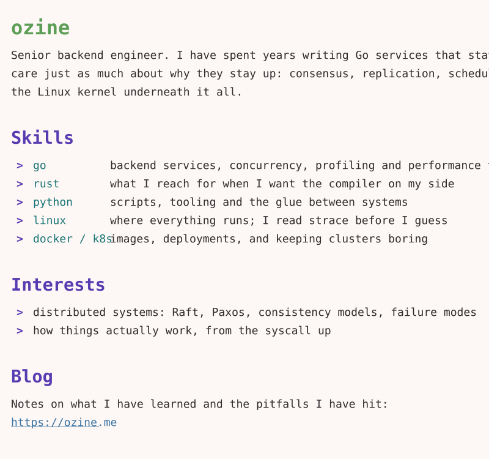

<!-- 卡片由 build.mjs 生成：改 build.mjs 里的 content / theme，运行 `node build.mjs`，提交 light.svg 和 dark.svg。 -->
<a href="https://ozine.me">
  <picture>
    <source media="(prefers-color-scheme: dark)" srcset="dark.svg">
    
  </picture>
</a>

[blog](https://ozine.me) · [twitter](https://x.com/ozine_x) · [email](mailto:ozinedev@proton.me)
